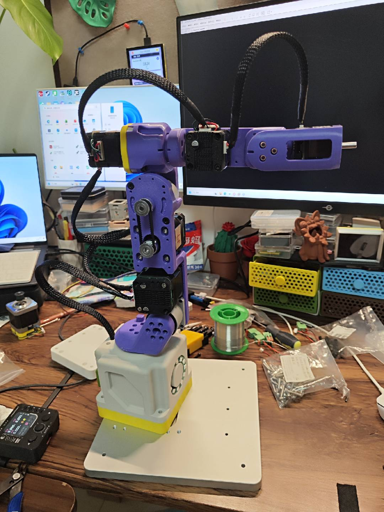
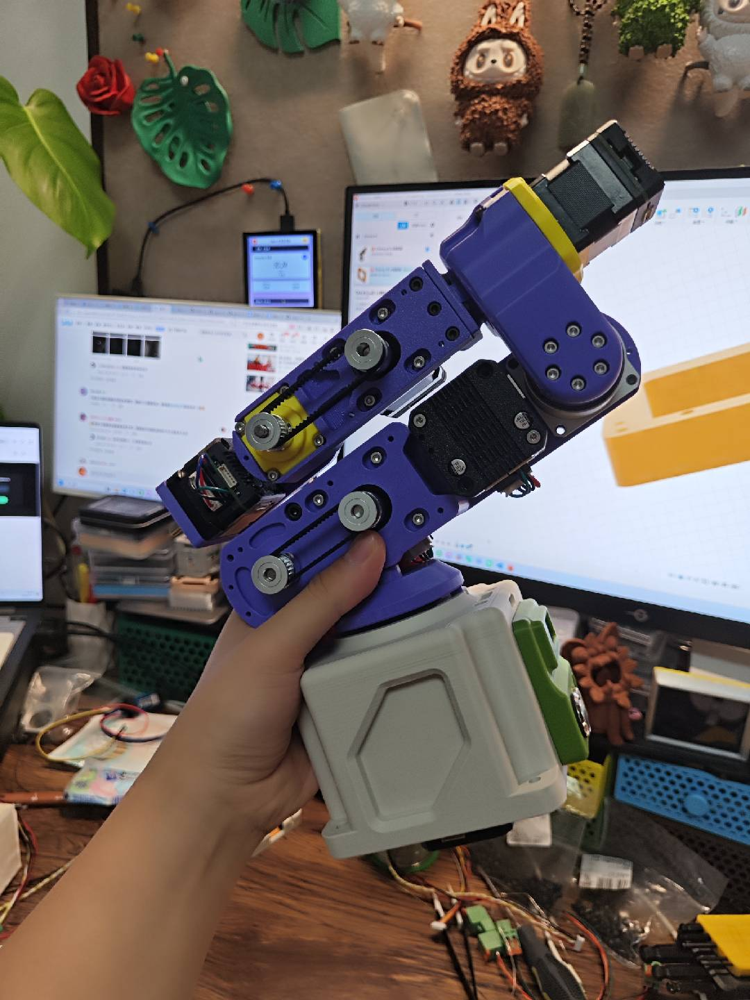

### 关于「Dummy-Robot」机械臂的一切
### Author: kkl



该笔记目前处于积极开发阶段。



**_-> 先来个成品展示：_**



<figure>

<figcaption></figcaption>
</figure>

<figure>

<figcaption></figcaption>
</figure>

<figure>

<figcaption></figcaption>
</figure>

<figure>

<figcaption></figcaption>
</figure>





很久以前就有想要复刻dummy的想法了，但是那时候大学还没有毕业，钱包吃紧，于是还没开始就结束了。

这次刚好工作上没这么忙，也有一定固定的经济收入，加上想要学习比较前沿的VLA模型、经典运动学控制理论等，机械臂是一个非常不错的选择。作为一个完全开源的项目，dummy无论从技术含金量、性价比到生态来说都是非常值得的项目。过程中从零到一，电路布局、电机算法、结构设计、通信协议、姿态控制，对我而言都十分新颖，十分有参考意义。

That‘s enough！我大致是从国庆节那段时间开始做起的，本来想着趁着十一假期把所有需要用到的步进电机和控制板的pcb都焊接好，没想到物流和淘宝商家都放假了，等待永远在占用时间的大头（sad。后面陆陆续续做下来，一共8块pcb、6个步进电机、5个谐波减速。用pla打印了结构件验证了方案，然后因为材料刚性问题运动起来十分的抖动明显，最后换成了cnc，稳定性变得非常的好。精度还没有测试，目测还是很不错的，后续可以重复测试打一下千分表。

截至现在2026.11.12，目前已经实现了机械臂的基本功能，第一次复刻dummy，我是复刻的任同学的版本，给自己留了一些试错成本，总体花费大概在3k - 4k，开销大头主要还是在谐波减速器和cnc上。这一路上还是踩了不少坑的，打螺丝、装电机、装谐波的经历还历历在目，每次装配都手忙脚乱装配大半天，特别是换cnc的时候还要把原来装好的手子又全部拆下来，再装一次，现在闭眼都能装了（熟能生巧简直了...，其中记录了一些过程，一些tips，一些可以优化的点，后面会慢慢更新。

这个帖子主要还是为了记录学习运控相关算法、通信协议等的内容，同时后续加入深度视觉后，基于这个手子入坑一下其他更加深入的机械臂玩法：重力补偿、拖动示教、轨迹规划、柔顺、笛卡尔空间阻抗控制等等。可以期待一下嗷！

**-- 2026.11.12**




...


---

### 写在前面

**_本篇文章将简述如何从零到一玩转「Dummy-Robot」。_**

---

### 开始

...

---

### 写在后面

#### 资源获取

**DUMMY 机械臂 V2版本视频中展示模型全部资料，任同学整理：**
链接：https://pan.quark.cn/s/48411f1e7d93
提取码：UvkP

**3D打印元器件盒子文件分享：**
链接：https://pan.baidu.com/s/1F3lQocbQdISGxdsj9VTw_w?pwd=7531 
提取码：7531

#### 鸣谢

- 稚晖君：https://github.com/peng-zhihui/Dummy-Robot
- 不爱学习任同学：https://www.bilibili.com/video/BV18x421Q7Td/
- 木子晓汶：https://gitee.com/switchpi/dummy
- arthur-zhu：https://www.bilibili.com/video/BV1Gy421h7MS/
