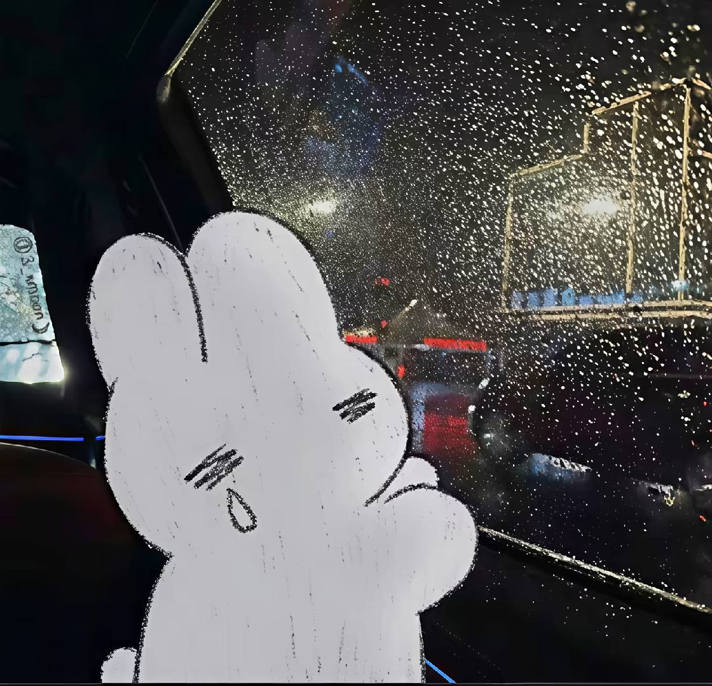

### 杂记丨11月：期待再相逢
### Author：@kkl

---

### 写在前面

<!-- 看看极光 -->

<ascii-art piece="aurora-fjord"></ascii-art>

_**期待再相逢...**_

<!-- use Custom Address -->

<!-- require APlayer -->
<link rel="stylesheet" href="https://cdn.jsdelivr.net/npm/aplayer/dist/APlayer.min.css">

<!-- require MetingJS -->

<meting-js
	server="netease"
	type="song"
	id="1434547183">
</meting-js>

hey!

真是没有想到，完全没有想到，或者说我早就应该料到，没错，我也结束了这一段工作，迎接裁神了。

无论怎么说，我还是对这样的时间诞生的这样的结果感受到诧异的——我冥冥中知道这样的结局会到了，但是没有想过会这么快来，就夹在普普通通的工作日当中，稀松平常，一个加急电话，一条短信，一个会议室，几句简短的告知，两张纸，一支笔，一个署名，最后在飞书亲自提交上那份离职申请。原来，一切都这么简单，我终于也经历过，已经走掉的小伙伴们都走过的路，一条想象中很漫长很残酷的路，没想到这么高效迅速，快到，来不及悲伤...

当然，这些话，上面的这些想法，都是后知后觉的。我和老李被裁当天还跟俩没事人一样，上午摸了半天鱼，听说三楼的食堂开张了，我们就去尝了尝，各自点了一碗面，没想到这是我们在新食堂的里面吃的第一餐，也是最后一餐。正吃着，有一个同事凑过来：听说了吗，又要开始了，上午已经约谈了几个，很快轮到我们了。

我和老李相互对视一笑，希望这次不要再是烟雾弹嗷，之前第二波的时候也是这么搞心态，相继无声，继续吃面，该说不说，那里的手工碱水面是真的不错，非常的香，拌了好多好多碎蒜进去（笑。

下午照例和几个同事下楼拿咖啡，看到其他部门的同事聚在一起围成一个圈聊天，咖啡还没到，过去凑热闹，没想到，如此雷霆，一个两个已经约谈完了，我们一点信息也没有收到，于是咖啡也不拿了火速上楼。回到工位看到我们组的python的神已经在收拾工位，我方最强战力单位已经毕业了，那时就料到，我们应该也不远了。

后来的事情，就按照千篇一律的流程来走了，拿到了大礼包，然后几个同事晚上组了饭局，拍了最后的合影，结束了，就这么结束了。解散了。

如此的快，如此的猝不及防...

<figure>

<figcaption></figcaption>
</figure>

---

### 2026/11/3 - 期待再相逢
<!-- use Custom Address -->

<!-- require APlayer -->
<link rel="stylesheet" href="https://cdn.jsdelivr.net/npm/aplayer/dist/APlayer.min.css">

<!-- require MetingJS -->

<meting-js
	server="netease"
	type="song"
	id="26601429">
</meting-js>

...

### 2026/11/15 - 火烧简历2.0
<!-- use Custom Address -->

<!-- require APlayer -->
<link rel="stylesheet" href="https://cdn.jsdelivr.net/npm/aplayer/dist/APlayer.min.css">

<!-- require MetingJS -->

<meting-js
	server="netease"
	type="song"
	id="28310544">
</meting-js>

...

<!-- 热力图的挂件 -->

---

### 写在后面

_**期待再相逢...**_

...
