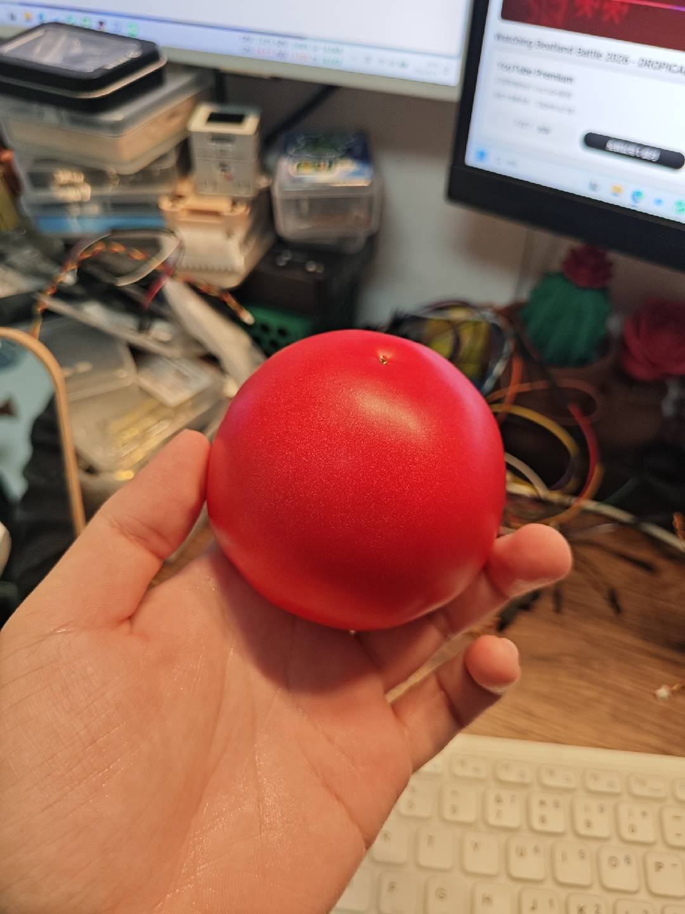

### 杂记丨11月：期待再相逢
### Author：@kkl

---

### 写在前面

_**期待再相逢...**_

<figure>

<figcaption></figcaption>
</figure>

---

### 2026/11/3 - 期待再相逢
<!-- use Custom Address -->

<!-- require APlayer -->
<link rel="stylesheet" href="https://cdn.jsdelivr.net/npm/aplayer/dist/APlayer.min.css">

<!-- require MetingJS -->

<meting-js
	server="netease"
	type="song"
	id="26601429">
</meting-js>

...

### 2026/11/15 - 火烧简历2.0
<!-- use Custom Address -->

<!-- require APlayer -->
<link rel="stylesheet" href="https://cdn.jsdelivr.net/npm/aplayer/dist/APlayer.min.css">

<!-- require MetingJS -->

<meting-js
	server="netease"
	type="song"
	id="28310544">
</meting-js>

...

<!-- 热力图的挂件 -->

---

### 写在后面

_**期待再相逢...**_

...
